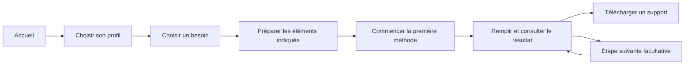

# Parcours et schémas · refonte du 5 novembre 2026

## Point de départ et limites

L’examen du site public a montré un menu cumulant accueil, sélection, catalogue, sources, aide, langue et téléchargement. L’accueil ajoutait trois appels à l’action, cinq questions, trois modes d’utilisation, trois méthodes, des kits, un glossaire, les sources, une FAQ et un protocole de test. Ces éléments utiles se concurrençaient avant même de choisir une tâche.

Les parcours ci-dessous sont des hypothèses de conception pour les trois publics demandés. Ils sont implémentés et vérifiés comme parcours fonctionnels. Aucun entretien, test avec participant ou gain de conversion n’est présenté comme réalisé.

## Besoins et user journeys

| Public et déclencheur | Besoin concret | Parcours proposé | Résultat utile | Point de friction traité |
| --- | --- | --- | --- | --- |
| Étudiant, examen à venir | Savoir quoi réviser et réserver du temps | Planning par blocs → Pomodoro → revue hebdomadaire | Planning réaliste, prochaine séance, ajustement | L’étudiant choisit un objectif avant de devoir connaître le nom d’une méthode. |
| Étudiant, travail collectif à rendre | Clarifier le livrable et répartir le travail | SMART → RACI → Kanban | Critères de réussite, responsabilités, tâches visibles | Les consignes de préparation expliquent ce qu’il faut avoir sous la main. |
| Manager, trop de demandes | Aligner l’équipe sur des priorités | Impact–effort → MoSCoW → DACI | Sélection, périmètre et responsable de décision | Les étapes sont facultatives ; la première méthode peut suffire. |
| Manager, fin de cycle | Transformer un bilan en amélioration concrète | Quatre L → commencer/arrêter/continuer → Eisenhower | Une action, un responsable et une date | Le parcours donne une suite au recueil d’observations. |
| Professionnel, journée saturée | Faire une sélection et protéger son temps | Eisenhower → timeboxing → clôture de journée | Priorités, limites de durée, prochaine action | L’entrée décrit la situation vécue plutôt qu’une famille de frameworks. |
| Professionnel, recommandation à un client | Expliquer et défendre un choix | Matrice pondérée → prémortem → DACI | Critères, risques et décision explicites | Les réponses sont conservées entre les étapes et réunies dans un bilan téléchargeable. |

Le parcours spécialisé de priorisation de backlog reste accessible à son adresse existante. Il complète ces six entrées sans ajouter un choix de premier niveau.

## User flows mis en place

Une personne qui connaît déjà une méthode peut suivre le chemin court : **Méthodes → recherche → fiche → canevas ou présentation**. Le sélecteur à cinq questions reste disponible depuis « Aide-moi à choisir » dans le catalogue, avec ses cinq questions visibles sur un écran dédié.

L’étape en cours et le retour au parcours apparaissent sur chaque fiche ouverte depuis un parcours. Les réponses restent dans l’onglet lors du passage à l’étape suivante et lors du retour en arrière. Le bilan Markdown réunit les seules méthodes auxquelles la personne a répondu. Le kit hors ligne, distinct de ce bilan personnel, contient les exemples publics et une application vierge.

## Hiérarchie de l’interface

- Menu principal : **Commencer**, **Méthodes**. Le logo ramène à l’accueil.
- Menu **Plus** : téléchargement HTML, aide, sources et changement de langue. Il se ferme au clic extérieur et avec Échap.
- Accueil : un profil et deux situations concrètes, puis un accès direct au catalogue. Les longues sections annexes quittent cet écran.
- Catalogue : recherche en premier. Familles, préférences et suggestions sont regroupées dans « Affiner les résultats » ; les filtres actifs restent réinitialisables.
- Fiche : titre plus compact et trois espaces conservés, guide, canevas et présentation. Comparaisons, exercices et partage détaillé sont consultables à la demande.
- Présentation : l’aperçu et les exports sont prioritaires. Le plan des huit diapositives est replié par défaut.

L’identité existante est conservée : papier, encre, accent orange, typographie système, angles droits et séparations fines. Aucun visuel propriétaire ni nouvelle dépendance externe n’est ajouté.

## Correction des axes

Les quatre matrices concernées sont Eisenhower, impact–effort, SWOT et audit d’énergie. Leurs dimensions sont nommées séparément de leurs extrémités : axe horizontal en bas, axe vertical à gauche, extrémités gauche/droite et haute/basse explicites. Le quadrant « Faire maintenant » d’Eisenhower reçoit l’accent visuel. SWOT indique correctement « Favorable » en haut et « Défavorable » en bas, avec « Interne » à gauche et « Externe » à droite.

Pareto possède une échelle de valeurs à gauche et une échelle de pourcentages cumulés à droite. Les causes sont nommées sous les barres ; la ligne à 80 % est un repère de cumul. La valeur de l’axe gauche suit le total réel et ne suppose pas systématiquement 100 observations.

Ces éléments utilisent les mêmes instructions de dessin pour l’écran, le PDF et le PowerPoint, dans les formats 16:9, 9:10 et 9:16. Les titres verticaux restent du texte natif modifiable dans PowerPoint.

## Vérifications

Les scénarios navigateur couvrent les trois profils : choix du besoin, ouverture de la première méthode, saisie, étape suivante, retour et export d’un bilan contenant les réponses. Ils couvrent aussi le menu mobile, l’aide, la langue, le mode hors ligne, les sauvegardes et les exports existants. Le contrôle des axes vérifie la place des dimensions, leurs extrémités, les deux échelles Pareto et le texte natif des exports.

Les résultats chiffrés et les liens de publication sont consignés dans le rapport de livraison. Les tests sur appareils physiques et avec de vrais participants restent à effectuer.
